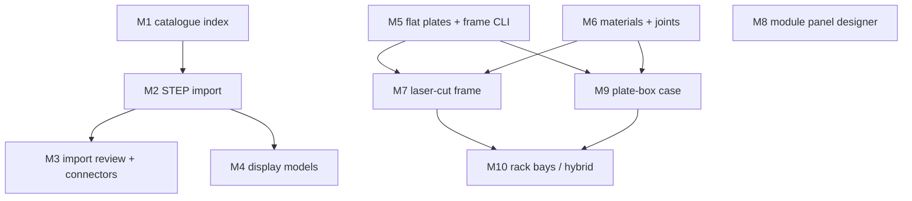

# Development Plan — Catalogue, Part Models and Eurorack Case Styles

## 1. Context & Source Map

hwcase builds laser-cut cases around real hardware (the layered pipeline) and
Eurorack frames from the format (the rack pipeline). This plan makes the
Adafruit catalogue import reliable, including STEP-only models; shows parts as
their real CAD models; and extends Eurorack support from the U-channel frame to
fully laser-cut frames, module panels carrying Adafruit parts, and hybrid cases
that put a rack bay and Adafruit parts in one laser-cut box.

It supersedes the 2026-09-06 U-profile plan. That plan's M1–M7 are delivered;
its open export and command-line work (old M8/M9) is absorbed into M5 here.

| Plan section | Source |
| --- | --- |
| §6 M1–M3 | `.docs/REVIEW_CATALOG_MODELS_EURORACK.md` Part 1, findings F1–F11, plan C1–C7 |
| §6 M4 | same, Part 2, plan M1–M7 |
| §6 M5–M7 | same, Part 3, "Foundation" G1–G3 and "Style B"; old plan M8 (exports, cut list, BOM) |
| §6 M8 | same, Part 3, "Style C"; `docs/eurorack.md` §§2–3, 8 |
| §6 M9–M10 | same, Part 3, "Style D" D1–D2 |
| Decisions D-1…D-5 | Builder's answers, 2026-10-16: (1) both joint types; (2) sheet thickness is dynamic; (3) modules sit on the rails and that is the upper surface — any further surface aligns with the modules; (4) no tilted rows; (5) STEP reading must be implemented |
| One-run execution | Builder's request, 2026-10-16: "implemented in one longer run via team-lead" |

## 2. Assumptions & Gaps

> **ASSUMPTION A-1 — one run, one integration branch.** The whole plan runs in
> one team-lead session. Each milestone is a stack of branches off
> `feat/catalog-models-eurorack`; after its `GO`, the run merges the stack into
> that integration branch, and that merge counts as "externally merged" for
> dependency purposes. The builder merges the integration branch into `master`.

> **ASSUMPTION A-2 — deck height.** Per D-3, the module panel's front face is
> the case's upper surface. Modules rest on the rail's front face, so
> `deck top = rail front face + module panel thickness`. The thickness is a
> setting, `module_panel_t`, defaulting to 2.0 mm (Doepfer's aluminium panel,
> `docs/eurorack.md` §4).

> **ASSUMPTION A-3 — dynamic thickness (D-2).** Sheet thickness, kerf and joint
> clearance are per material and user-set, never constants. Joint tests are
> parametrised over thicknesses of 2.0–8.0 mm.

> **ASSUMPTION A-4 — libraries.** STEP is read with `cascadio` through trimesh
> (required dependency, D-5). Display meshes are reduced with
> `fast_simplification`. Both have wheels for CPython 3.10 on Windows (the local
> venv) and 3.12 on manylinux (the Docker image), verified 2026-10-16;
> `cascadio` is about 16–27 MB. The GLTF loader is vendored from three.js r169,
> the release already vendored, together with its `BufferGeometryUtils`
> dependency.

> **ASSUMPTION A-5 — panel rail holes, horizontal.** `docs/eurorack.md` §3 fixes
> the hole height (3.0 mm from each edge) and says the horizontal position is
> free on a 5.08 mm grid. M8 uses Doepfer's convention of 7.5 mm from the left
> edge, plus a second column for panels of 12 HP and up; M8's design gate
> confirms it against the Doepfer source cited in `docs/eurorack.md`.

> **ASSUMPTION A-6 — captive nut.** T-slot joints use an ISO 4032 M3 hex nut
> (5.5 mm across flats, 2.4 mm thick) and an M3 bolt; sizes are table entries,
> not constants, so M2.5 and M4 can be added.

> **ASSUMPTION A-7 — import baseline.** The full repository survey downloads
> roughly a gigabyte, so acceptance uses a deterministic sample of 40 folders
> (`--sample 40 --seed 1`). The full survey is an optional manual run.

> **GAP-1 (release policy).** No tags, no `CHANGELOG.md`, no CI, and `gh` is not
> installed. Every milestone targets `unversioned`; "green" means the local
> verification commands pass. No milestone creates version, changelog, tag or
> publication work.

## 3. Dependency Graph

## 4. Release Trains

| Target release | Included milestones | Preparation trigger | Required artifacts | Verification | Publication |
| --- | --- | --- | --- | --- | --- |
| `unversioned` | `M1`–`M10` | All included milestones merged into `feat/catalog-models-eurorack` | `none` — GAP-1 | `cd backend; python -m pytest tests/ -q` exits 0 and `cd web; node --test tests/` exits 0 | `not requested` |

`python` means the project venv (`.venv\Scripts\python` on Windows). The full
backend suite takes about 18 minutes; each milestone names a faster subset for
its branches and runs the full suite once per milestone, before its verdict.

## 5. Plan Evolution Protocol

- The committed plan and prompt files are authoritative. The ignored history
  ledger is reconstructible local evidence.
- Before each milestone, inspect its current plan/prompt, source map, current
  codebase, merged predecessor diffs, predecessor verification evidence, and the
  local history when available.
- Record exactly one `DESIGN GO — PLAN REVISION: none`,
  `DESIGN GO — PLAN REVISION: <entry IDs>`, or
  `DESIGN NO-GO — REASON: <blocking evidence>`.
- A material mismatch updates the current milestone and every directly or
  transitively affected future milestone in both authoritative files. Recompute
  the dependency graph, critical path, and release-train membership when
  affected.
- `DESIGN NO-GO` blocks code. A material plan revision requires a docs-only
  reconciliation commit on the integration branch, verified, before
  implementation (A-1).

## 6. Sections & Milestones

### Section A — The Adafruit catalogue

#### M1 — Catalogue index, freshness and an import baseline

| Field | Value |
| --- | --- |
| Objective | The CAD index lists every product folder and file from one pinned git-tree request, stays fresh in a long-running server, and import success is measured. |
| In / Out of scope | In: tree-based index (product → folders → files with sizes, commit SHA), TTL re-check per request, optional `GITHUB_TOKEN`, `importable` from available formats, discontinued/stock flags, download size cap, `tools/import_survey.py`. Out: STEP reading (M2), UI changes beyond the flags, background import jobs on a hosted instance (later). |
| Depends on | `none` |
| Target release | `unversioned` |
| Deliverables | `catalog.py` index rebuilt on the git tree API; `ingest.py` downloads from the indexed file list; `HWCASE_MAX_CAD_MB` (default 64); `tools/import_survey.py --sample N --seed S` writing a CSV and a summary; the sample-40 result committed as `tools/import_survey_baseline.csv`; the false "refreshed on a timer" docstrings corrected. |
| Acceptance | (1) A fixture tree with two folders for one product ID yields both. (2) With a cache older than the TTL, the next search in the same process refreshes (fetch is stubbed). (3) A STEP-only product reports `importable: false` until M2. (4) A download over the cap fails with an error naming the file and the cap. (5) Search results carry `discontinued` and `in_stock`. (6) `tools/import_survey_baseline.csv` exists and holds the sample-40 result. |
| Verification | `cd backend; python -m pytest tests/test_catalog.py -q` → 0 failures; `python ../tools/import_survey.py --sample 40 --seed 1` prints a summary line. |
| Design reevaluation | Re-check the tree API's `truncated` flag and the 60/h unauthenticated limit. Dependents: **M2, M3, M4**. |
| Risks & rollback | Rebuilding the index can hide products if the folder-name parser regresses; the fixture covers all six duplicate-ID cases. Rollback: the stack. |
| Est. PRs | 2 |

#### M2 — STEP import and geometry checks

| Field | Value |
| --- | --- |
| Objective | A product with only a STEP model imports with real geometry, and an import is checked before it is trusted. |
| In / Out of scope | In: `cascadio` as a required dependency, STEP tessellation into bodies, holes from the same STEP, hole-placement checks, unit sanity, true board outline from the board body's projection. Out: connectors (M3), display meshes (M4). |
| Depends on | `M1` |
| Target release | `unversioned` |
| Deliverables | `requirements.txt` gains `cascadio`; `measure.bodies` accepts STEP; `ingest.draft_part` prefers STEP when present; `outline: poly` when the projection fills under 95 % of its bounding box; warnings for holes outside the board or inside a component, and for implausible units; `importable` true for STEP-only products. |
| Acceptance | (1) The vendored 3954, 4741 and 5752 models import from STEP with outlines within 0.3 mm of their STL imports. (2) A STEP-only fixture imports. (3) A round-board fixture gets a `poly` outline. (4) A fixture with holes shifted off the board produces a warning and no holes. (5) The sample-40 survey's success count is at least `tools/import_survey_baseline.csv`'s plus every STEP-only folder in the sample, and the baseline file is updated. (6) The existing ingest and audit tests still pass. |
| Verification | `cd backend; python -m pytest tests/test_catalog.py tests/test_step.py -q` → 0 failures; `python ../tools/import_survey.py --sample 40 --seed 1`. |
| Design reevaluation | Confirm `cascadio` installs in the Docker image (`docker build .`, manual where Docker is unavailable). Dependents: **M3, M4**. |
| Risks & rollback | STEP tessellation can differ from the vendor STL; (1) bounds it. Rollback: the stack. |
| Est. PRs | 2 |

#### M3 — Import review and connector proposals

| Field | Value |
| --- | --- |
| Objective | An import is reviewed before it is saved, and comes with proposed connectors instead of none. |
| In / Out of scope | In: preview endpoint, model-file choice, turn-over override, connector signature library, editor import dialog. Out: mesh preview (boxes are enough here), editing connectors in the UI. |
| Depends on | `M2` |
| Target release | `unversioned` |
| Deliverables | `POST /api/catalog/preview/{pid}?file=&flip=` returning the draft, warnings and candidate files; `hwcase/connectors.py` matching body sizes to STEMMA QT, JST PH 2/3/4, USB-C, micro-B, 3.5 mm jack and 2.54 mm headers, with the face taken from the nearest board edge and every proposal tagged `estimated`; product-name keywords as a prior; the editor's import step showing file choice, turn-over and warnings before saving. |
| Acceptance | (1) The 4741 OLED proposes two STEMMA QT connectors on opposite edges with the correct faces. (2) A body away from every edge is never proposed as a connector. (3) `flip=true` overrides the heuristic and is recorded in the part's notes. (4) A folder with several models offers all of them. (5) Proposed connectors produce `unverified` issues in `check`. (6) Web store tests cover the dialog's state. |
| Verification | `cd backend; python -m pytest tests/test_connectors.py tests/test_catalog.py -q`; `cd web; node --test tests/` → 0 failures. |
| Design reevaluation | Re-read the measured sizes of the connectors already in `backend/parts/*.yaml`; they are the signature fixtures. Dependents: **none**. |
| Risks & rollback | A false connector makes the case cut a hole that is not needed; proposals stay `estimated` so the issues pane flags them. Rollback: the stack. |
| Est. PRs | 3 |

#### M4 — Display models

| Field | Value |
| --- | --- |
| Objective | Parts with vendor CAD are shown as their real model in the editor and the photograph, while every check and cut still uses the boxes. |
| In / Out of scope | In: `model:` block on `Part`, GLB generation with a triangle budget, model route, vendored GLTF loader, lazy loading, view toggle, renderer use, alignment audit, PCB colour and a neutral metal for components. Out: colours from STEP/3MF; models for the hand-written parts (Raspberry Pi, HyperPixel, AMYboard) and any part without an Adafruit model — later, part by part. |
| Depends on | `M2` |
| Target release | `unversioned` |
| Deliverables | `Part.model` (file, units, offset, flip, rotation, colour) written by the importer and added to the three vendored Adafruit parts; cached GLB per part, at most 40 k triangles by default; `GET /api/parts/{id}/model.glb`, fetched only when real models are switched on; **view → real models**, with boxes drawn as outlines and selection/ghosting still on boxes; `raytrace` writes the meshes; `audit` checks model bounds against the part's boxes. |
| Acceptance | (1) The three vendored Adafruit parts have models within the triangle budget. (2) Each model's bounds in the part frame are within 0.5 mm of the part's box envelope, checked by `audit --strict`. (3) `/api/build` output is byte-identical with models on or off. (4) `build_scene_dict` includes model meshes for parts that have them (testable without Mitsuba). (5) A part without a model still renders as boxes. |
| Verification | `cd backend; python -m pytest tests/test_models.py -q`; `python -m hwcase.cli audit --strict` → exit 0; `cd web; node --test tests/`. Manual: toggle real models on `soundmachine-v0`. |
| Design reevaluation | Confirm r169's `GLTFLoader.js` import graph before vendoring. Dependents: **none**. |
| Risks & rollback | A misaligned model is worse than none; (2) gates it. Rollback: the stack. |
| Est. PRs | 3 |

### Section B — Plates and joints

#### M5 — Flat plates as cut parts, and frames from the command line

| Field | Value |
| --- | --- |
| Objective | Every cut piece from either pipeline is a flat part that packs onto stock sheets, and a frame builds and exports from the command line. |
| In / Out of scope | In: a shared flat-part interface, generalised sheet packing, rack sheet export (SVG/DXF), rack cut list (plates, rails with lengths and counts, M5 count, U-channel order), CLI `check`/`build` dispatch on `kind`. Out: joints (M6), new frame styles (M7). |
| Depends on | `none` |
| Target release | `unversioned` |
| Deliverables | `hwcase/flat.py` (`FlatPart`: name, material, outline with holes, engrave, notes, datum edge); layers and rack plates both produce it; `export.pack_sheets` takes flat parts; `/api/export/sheets/{fmt}` and `cli build` work for `kind: rack`; `cli check` prints the frame summary for a rack scene. |
| Acceptance | (1) Every existing layered scene exports byte-identical sheets before and after. (2) `build` on `frame-6.yaml` writes at least one sheet file and a cut list naming both side panels, every rail with its length, the M5 count (= 2 × rails) and the U-channel order. (3) Side-panel hole centres in the DXF match the model within 0.01 mm. (4) `build` on a rack scene never writes a layered case. |
| Verification | `cd backend; python -m pytest tests/test_flat.py tests/test_rack.py -q`; `python -m hwcase.cli build scenes/frame-6.yaml -o ../out`. |
| Design reevaluation | Confirm `pack_sheets` has no layered-only assumptions left (layer index, z). Dependents: **M7, M9, M10**. |
| Risks & rollback | Changing the packer can reorder existing exports; (1) is the guard. Rollback: the stack. |
| Est. PRs | 3 |

#### M6 — Materials and joints

| Field | Value |
| --- | --- |
| Objective | Two plates meeting at an edge can be joined with finger joints or captive-nut T-slots, computed from each material's own thickness. |
| In / Out of scope | In: per-material thickness, kerf and joint clearance (D-2); `hwcase/joinery.py` for finger joints and T-slots; keep-clear zones; validation. Out: using joints in any case (M7, M9). |
| Depends on | `none` |
| Target release | `unversioned` |
| Deliverables | Material model with user-set thickness, kerf, clearance and finish (for the renderer); `finger_joint(edge, a, b)` and `tslot_joint(edge, a, b, fastener)` cutting matching geometry into both plates; fastener table (M3 per A-6); `validate_joint` reporting every violated rule. |
| Acceptance | Parametrised over thicknesses 2.0–8.0 mm and both joint types: (1) every tab has a slot sized to tab plus clearance; (2) finger patterns are complementary, with no overlap and no gap beyond the clearance after kerf; (3) each nut trap holds the nut plus clearance and the bolt hole lines up with it; (4) no joint feature comes within the keep-clear distance of a declared hole; (5) each plate stays one piece. |
| Verification | `cd backend; python -m pytest tests/test_joinery.py -q` → 0 failures. |
| Design reevaluation | Agree the edge representation with M5's `FlatPart` datum. Dependents: **M7, M9, M10**. |
| Risks & rollback | Joints are where a laser job fails at assembly; the property tests cover the full thickness range. Rollback: the stack. |
| Est. PRs | 2 |

#### M7 — Fully laser-cut Eurorack frame

| Field | Value |
| --- | --- |
| Objective | A frame can be built from aluminium rails and laser-cut plates only, with no U-channel. |
| In / Out of scope | In: `rack.style: u_channel \| laser`; cheeks, base and back plates, optional top plate; joint type and material per frame; editor controls; exports through M5. Out: tilted rows (D-4), hybrid decks (M10), a front lip (D-3 makes the module face the upper surface, so nothing stands in front of it). |
| Depends on | `M5, M6` |
| Target release | `unversioned` |
| Deliverables | `rack.build` producing laser members; cheeks derived from today's side-panel outline plus joints; rails and M5 fixings unchanged; BOM without the U-channel and with M3 bolts and nuts; frame pane gains style, material thickness and joint type. |
| Acceptance | (1) Every existing frame (default `u_channel`) builds identical members. (2) A 68 HP, 6U, 51 mm laser frame has cheek M5 holes within 0.01 mm of the U-channel side panel's. (3) Every joint passes `validate_joint`. (4) Every plate fits the configured stock. (5) Changing the material thickness from 3 to 6 mm changes the slots and still validates. (6) The BOM's M3 nut count equals the number of T-slots. |
| Verification | `cd backend; python -m pytest tests/test_rack.py tests/test_joinery.py -q`; `cd web; node --test tests/`. |
| Design reevaluation | Confirm the rail and M5 arithmetic in `rack.py` is reused, not copied. Dependents: **M10**. |
| Risks & rollback | A cheek drilled to the wrong row stack scraps both cheeks; (2) is the guard. Rollback: the stack. |
| Est. PRs | 2 |

### Section C — Eurorack with Adafruit parts

#### M8 — Eurorack module panel designer

| Field | Value |
| --- | --- |
| Objective | A Eurorack module panel of any HP can be designed with library and catalogue parts behind it, and exported for cutting. |
| In / Out of scope | In: a panel project kind, panel outline from `eurorack.panel_width` and row format, oval rail holes, a depth check against module depth, standoff mounting, power-header parts, the AMYboard panel's rail-hole correction. Out: frames, joints. |
| Depends on | `none` |
| Target release | `unversioned` |
| Deliverables | `case.eurorack_panel: {hp, format, thickness, module_depth}` making the case a single panel sheet; rail holes per `docs/eurorack.md` §3 and A-5; boards mounted `from_lid` with standoff lengths in the cut list; an error for anything deeper than `module_depth`; 10- and 16-way power header parts; the existing engraving (labels, patterns) on the panel; `misc.yaml` AMYboard panel holes at y = 3.0 / 125.5, and every document that repeats the 123.5 mm error corrected; **new Eurorack module panel** in the project chooser. |
| Acceptance | (1) A 10 HP 3U panel is 50.50 × 128.50 mm with hole centres at y = 3.0 and 125.5. (2) A 12 HP panel has four rail holes. (3) A part reaching deeper than `module_depth` is an error. (4) The export is one panel with holes before the outline and labels on the engraving layer. (5) `git grep -n "123\.5" -- docs backend` prints nothing. (6) Layered scenes build byte-identically. |
| Verification | `cd backend; python -m pytest tests/test_panel.py -q`; `git grep -n "123\.5" -- docs backend` → empty output; `cd web; node --test tests/`. |
| Design reevaluation | Confirm A-5 against the Doepfer source. Dependents: **none**. |
| Risks & rollback | Changing the AMYboard panel's holes alters a shipped part; note it in its `src.note`. Rollback: the stack. |
| Est. PRs | 2 |

#### M9 — Plate-box case style

| Field | Value |
| --- | --- |
| Objective | A parts scene can be built as a box of jointed plates (deck, walls, floor) instead of a stack of layers, with every existing check still applying. |
| In / Out of scope | In: `case.style: box`; deck cutouts from the same faceplate logic; wall openings from the per-side connector policies; floor and deck screw holes with standoff lengths; box height from the hardware; joints from M6; exports through M5. Out: rack bays (M10). The box has four walls, so the back is one of them rather than an optional extra plate. |
| Depends on | `M5, M6` |
| Target release | `unversioned` |
| Deliverables | A box builder producing flat parts with poses; deck = panel plane; `per_connector` and `open_to_edge` openings projected onto the matching wall; `from_lid`/`from_floor` supports become holes plus standoff lengths in the cut list; editor case-style selector. |
| Acceptance | (1) `soundmachine-v0` with `style: box` builds, and its deck openings match the layered lid's in XY within 0.1 mm. (2) Every external `per_connector` port gets an opening in the wall it faces. (3) Every joint passes `validate_joint` and every plate fits the stock. (4) Layered scenes build byte-identically. (5) The cut list gives a standoff length per supported board. |
| Verification | `cd backend; python -m pytest tests/test_box.py -q` → 0 failures (it builds `soundmachine-v0` with `style: box` in a temporary copy); `cd web; node --test tests/` → 0 failures. |
| Design reevaluation | Confirm which `case.py` functions (outline, openings, supports) can be reused without layers. Dependents: **M10**. |
| Risks & rollback | Wall openings projected onto the wrong plate leave a port blocked; (2) is the guard. Rollback: the stack. |
| Est. PRs | 3 |

#### M10 — Rack bays: hybrid cases

| Field | Value |
| --- | --- |
| Objective | A box case can carry one or more Eurorack bays next to Adafruit parts, with the module faces as the case's upper surface. |
| In / Out of scope | In: `racks:` in a box-case scene; the deck aperture; internal cheeks jointed to deck and floor; rails; a module-space keepout; deck height per A-2; merged BOM and cut list; editor placement of a bay. Out: tilted rows (D-4), layered-stack hybrids, bus-board and power-supply parts (they can be placed as ordinary parts once they exist in the library). |
| Depends on | `M7, M9` |
| Target release | `unversioned` |
| Deliverables | Bay spec `{id, at, hp, rows, module_depth, module_panel_t}`; the bay sets the deck top to rail front face + `module_panel_t` (D-3); cheeks from M7 carrying the rails with M5s; a keepout of HP × rows × module depth in the collision checks; box depth grown to the deepest bay; one sheet set and cut list for the whole case. |
| Acceptance | (1) A fixture with an 84 HP 3U bay, a Raspberry Pi and the HyperPixel builds. (2) Deck top z equals rail front face z + 2.0 mm within 0.01 mm. (3) A board placed inside the module space is a collision error. (4) Cheek M5 holes line up with the rail ends within 0.01 mm. (5) Every joint validates and every plate fits the stock. (6) The cut list lists the rails, cheeks and deck. |
| Verification | `cd backend; python -m pytest tests/test_hybrid.py -q` → 0 failures; M10 runs last (§8), so its verdict is followed by the release-train verification. |
| Design reevaluation | Re-read D-3 and A-2 against M7's rail datum. Dependents: **none**. |
| Risks & rollback | A deck at the wrong height leaves modules proud or sunk; (2) is the guard. Rollback: the stack. |
| Est. PRs | 3 |

## 7. Cross-Cutting Concerns

- **Back-compatibility.** Layered scenes and U-channel frames must build
  byte-identically throughout; M5, M7, M8, M9 each assert it.
- **Measurement honesty.** Imported geometry keeps its confidence tags;
  proposed connectors are `estimated` (M3).
- **Dependencies.** `cascadio` and `fast_simplification` are the only new
  runtime dependencies (A-4). Both must install in the Docker image.
- **Hosted mode.** Downloads are capped (M1); models are served from the shared
  vendor cache (M4); nothing new is stored per user.
- **Irreversibility.** Hole positions that meet bought aluminium (rails, M5s)
  are asserted to 0.01 mm (M5, M7, M10).
- Release management: none — GAP-1.

## 8. Critical Path

| Order | Milestone | Why here |
| --- | --- | --- |
| 1 | M1 | Root of section A |
| 2 | M5 | Root of the longest chain |
| 3 | M6 | Independent; needed by M7 and M9 |
| 4 | M2 | After M1 |
| 5 | M3 | After M2 |
| 6 | M4 | After M2 |
| 7 | M7 | After M5, M6 |
| 8 | M8 | Independent |
| 9 | M9 | After M5, M6 |
| 10 | M10 | After M7, M9 — always last |

Critical path by estimated PRs: **M5 → M9 → M10** (9), ahead of M6 → M9 → M10
(8) and M1 → M2 → M3 (7). M10 runs last so that its verdict is followed by the
single release-train verification, with every milestone merged into the
integration branch.
